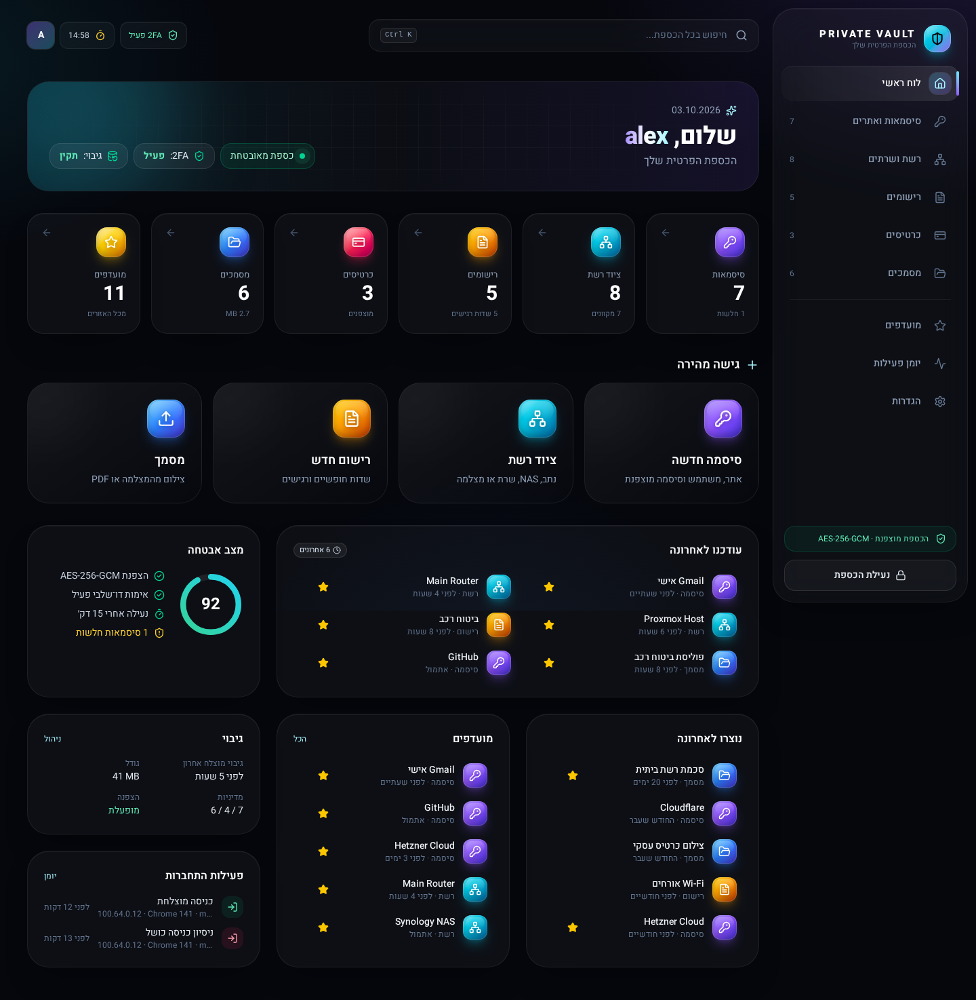
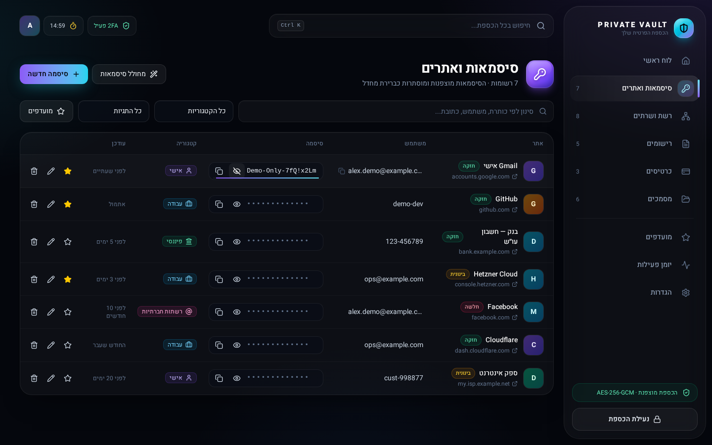
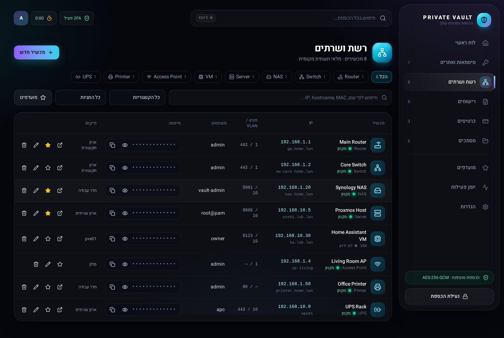
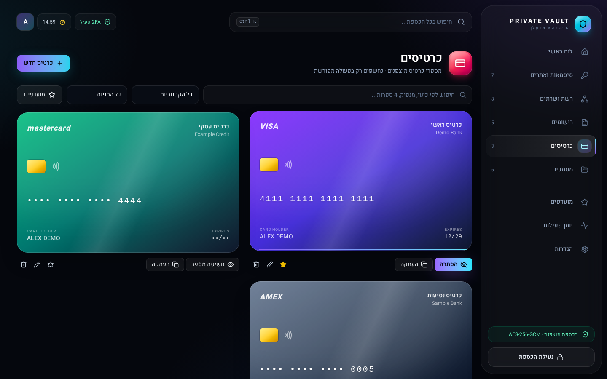
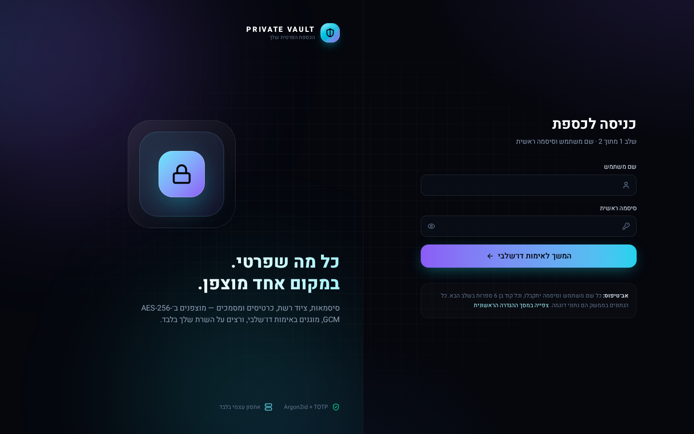
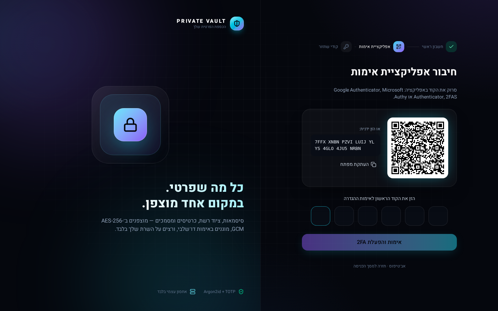

# PRIVATE VAULT

A self-hosted, Hebrew-first (RTL) personal vault for website passwords, network/server
credentials, flexible private records, payment cards and documents. Dockerized and portable:
everything lives in one directory so it can move from a VPS to a Proxmox VM or LXC.

> **Status: phase 3 — authentication and the vault data API are real; files and backups are not yet.**
> Setup, login (Argon2id + TOTP + recovery codes), sessions, CSRF, brute-force protection, the audit
> log, and passwords / network / records / cards (AES-256-GCM, reveal on demand) run against
> PostgreSQL. **Documents (file upload) and backups are still placeholders** (phases 4 and 6, see
> [docs/ARCHITECTURE.md](docs/ARCHITECTURE.md#development-phases)). Do not rely on it for real secrets
> until a backup exists. `npm run dev:mock` (frontend) runs the no-backend demo where any password is accepted.

| Dashboard | Passwords (one revealed) |
|---|---|
|  |  |
| **Network** | **Cards (number revealed)** |
|  |  |
| **Login** | **2FA setup** |
|  |  |

## Contents

- [Requirements](#requirements) · [Installation](#installation) · [Configuration](#configuration)
- [Docker commands](#docker-commands) · [First startup](#first-startup) · [2FA setup](#2fa-setup)
- [Backup](#backup) · [Restore](#restore) · [Updating](#updating)
- [Migration to another server / Proxmox](#migration) · [Security](#security-recommendations)
- [Development](#development) · [Troubleshooting](#troubleshooting)

## Requirements

- Linux host with Docker Engine 24+ and the Compose plugin
- 1 vCPU, 1 GB RAM free, a few GB of disk
- `openssl` (for generating secrets)
- Optional: Tailscale for private HTTPS access

## Installation

```bash
sudo git clone <this repo> /opt/private-vault-src
sudo cp -r /opt/private-vault-src/private-vault /opt/private-vault   # this directory
cd /opt/private-vault
cp .env.example .env
./scripts/generate-secrets.sh        # paste the output over the change-me values in .env
nano .env                            # set APP_ORIGIN, review the rest
chmod 600 .env
sudo chown 1000:1000 uploads         # the API container runs as uid 1000
docker compose up -d --build
```

Open `http://127.0.0.1:8080` (or your Tailscale HTTPS URL, see [docs/HTTPS.md](docs/HTTPS.md)).

## Configuration

All configuration is in `.env` (template: [.env.example](.env.example)). The API validates it at
startup and **refuses to start in production** if a secret is missing, too short, reused, or
still a placeholder. Key variables:

| Variable | Meaning |
|---|---|
| `APP_ORIGIN` | Exact URL the UI is opened from; writes from other origins are rejected |
| `VAULT_BIND` / `VAULT_PORT` | Where nginx listens on the host (default `127.0.0.1:8080`) |
| `POSTGRES_ADMIN_*` | Superuser of the dedicated DB container (init/backups only) |
| `POSTGRES_DB` / `POSTGRES_USER` / `POSTGRES_PASSWORD` | App database and its restricted role |
| `ENCRYPTION_KEY` | 32-byte base64 key for vault data. **Losing it = losing the data** |
| `TOTP_ENCRYPTION_KEY` | Separate key for TOTP secrets |
| `APP_SECRET`, `SESSION_SECRET` | Signing secrets |
| `BACKUP_PASSPHRASE` | Encrypts backup archives |
| `SESSION_IDLE_MINUTES` (15), `SESSION_ABSOLUTE_HOURS` (12), `TRASH_RETENTION_DAYS` (30) | Behaviour |
| `ALLOW_CVV_STORAGE` | Leave `false` |

For local testing over plain HTTP set `NODE_ENV=development`, `COOKIE_SECURE=false` and
`APP_ORIGIN=http://127.0.0.1:8080`.

## Docker commands

```bash
docker compose up -d --build         # build and start
docker compose ps                    # all four should be "healthy"
docker compose logs -f private-vault-api
docker compose down                  # stop (data stays in database/data, uploads/)
docker compose exec private-vault-api wget -qO- http://127.0.0.1:4000/api/health   # internal health
```

Containers: `private-vault-nginx` (only published port), `private-vault-app` (Next.js UI),
`private-vault-api` (Fastify API, runs DB migrations on start), `private-vault-db` (PostgreSQL 17,
never published). Network `private_vault_network` is internal-only.

## First startup

The API applies migrations automatically. Open the site: with no account yet it goes to
**/setup**. Enter the `SETUP_TOKEN` from your `.env` (this stops a stranger who reaches the URL
first from becoming the owner), choose the single master account (username + strong password,
stored as an Argon2id hash), scan the QR code, confirm the first 6-digit code, and save the 10
recovery codes, which are shown once. If you close the page midway, log in with your password and
setup resumes.

## 2FA setup

Any RFC 6238 TOTP app works: Google Authenticator, Microsoft Authenticator, 2FAS, Authy.
Scan the QR code (or type the key), enter the first 6-digit code to activate, then store the 10
one-time recovery codes offline. Every login requires password **and** code; there is no
"remember this device". Lost phone → use a recovery code; lost both → see
[docs/SECURITY.md](docs/SECURITY.md#recovery-without-permanent-lockout).

## Backup

Implemented in phase 6 per the build plan; design in [docs/BACKUP.md](docs/BACKUP.md):
`scripts/backup.sh` (PostgreSQL dump + encrypted uploads + DR config, each encrypted;
retention 7 daily / 4 weekly / 6 monthly in `backups/`), optional copy to NAS/server/S3.
Until then, a manual cold copy works: `docker compose down && tar -czpf ~/vault.tgz -C /opt private-vault`.

**Always keep an offline copy of `.env`.** Backups cannot be decrypted without it.

## Restore

`scripts/restore.sh <backup-dir>` (phase 6) verifies checksums, takes a safety backup of the
current state, restores database and uploads, and runs migrations.

## Updating

```bash
cd /opt/private-vault
git pull                       # or copy the new release over, keeping .env and data dirs
docker compose up -d --build   # migrations run automatically, forward-only
```

## Migration

To another server, a **Proxmox VM** or a **Proxmox LXC**: see [docs/MIGRATION.md](docs/MIGRATION.md).
Short version: copy the directory (including `.env`, `database/data` with the stack stopped, and
`uploads/`), or restore a backup on the new host. Accounts, 2FA and audit history are in the
database and move with it.

## Security recommendations

- Access only over Tailscale or a private network ([docs/HTTPS.md](docs/HTTPS.md)); never expose publicly.
- Keep `VAULT_BIND=127.0.0.1` unless binding a tailnet IP.
- `chmod 600 .env`; keep an offline copy of `.env` and the recovery codes.
- Enable HSTS in `nginx/conf.d/vault.conf` once HTTPS is in place.
- Update monthly. Full model: [docs/SECURITY.md](docs/SECURITY.md).

## Development

```bash
# UI prototype
cd app/frontend && npm install && npm run dev        # http://localhost:3000
npm run lint && npm run typecheck && npm run build

# API core
cd app/backend && npm install
npm test                                             # encryption + config tests
npm run lint && npm run typecheck
```

Structure:

```
private-vault/
├── docker-compose.yml   .env.example   README.md
├── app/frontend/        Next.js 16 UI (RTL, dark, mock data in src/lib/mock-data.ts)
├── app/backend/         Fastify API, migrations/, src/crypto, src/config, src/db
├── database/init/       creates the restricted app role on first DB start
├── nginx/               reverse proxy + security headers
├── scripts/             generate-secrets.sh (backup.sh / restore.sh in phase 6)
├── uploads/  backups/   runtime state (git-ignored)
└── docs/                ARCHITECTURE, SECURITY, HTTPS, MIGRATION, BACKUP
```

## Troubleshooting

| Symptom | Fix |
|---|---|
| `private-vault-api` restarting, log says `Invalid configuration` | A secret in `.env` is missing/placeholder; the log names the variable (never the value) |
| API unhealthy, health shows `"storage":"fail"` | `sudo chown 1000:1000 uploads` |
| Login loops back over HTTP | `COOKIE_SECURE=true` needs HTTPS; for local tests set it to `false` |
| `/api/health` returns 404 from the browser | Intended; query it from inside the network (see Docker commands) |
| Port 8080 busy | Change `VAULT_PORT` |
| DB init script didn't run | It only runs on an empty `database/data`; it is skipped on existing clusters |
